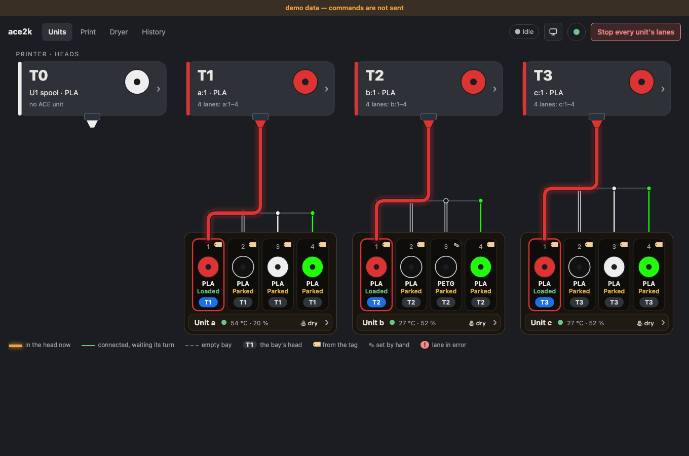
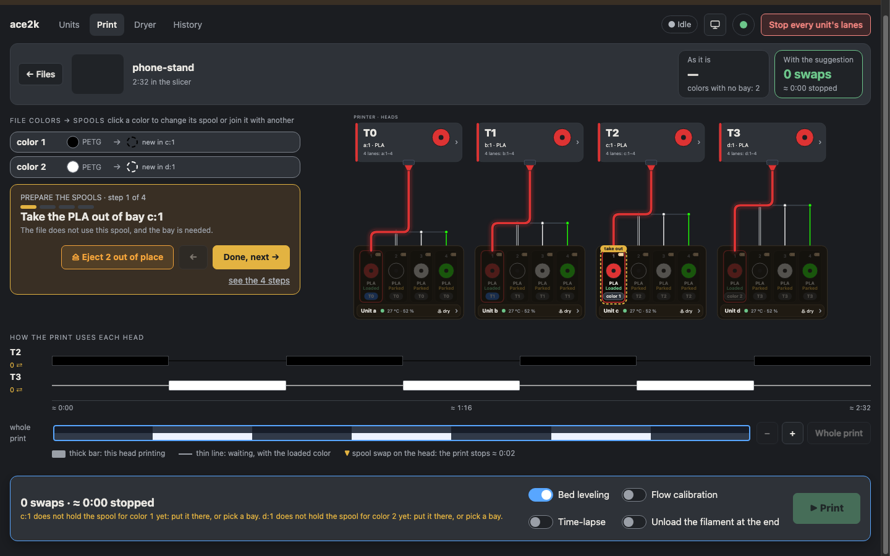
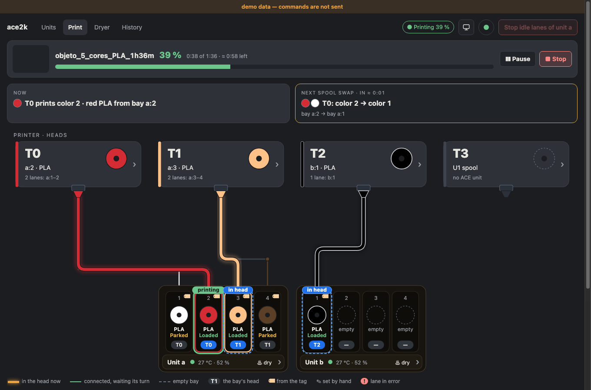
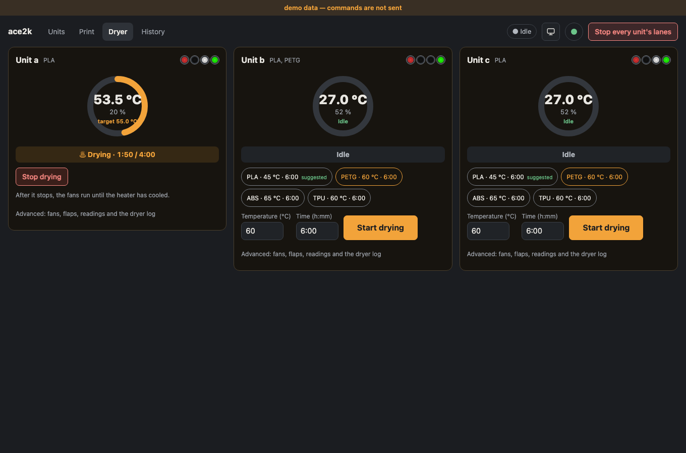
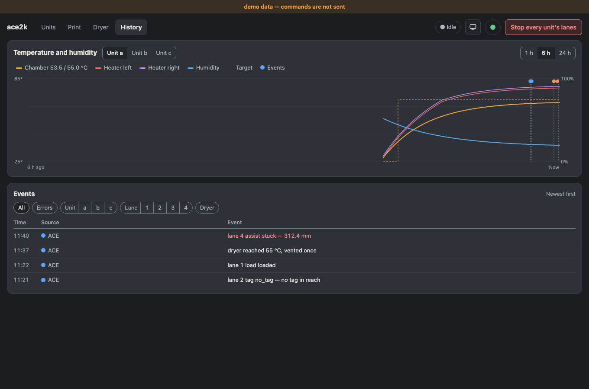

# ace2k-u1

The Snapmaker U1 side of [ace2k](https://github.com/tobecwb/ace2k), the open firmware that makes
the **Anycubic ACE 2 Pro** a native **Klipper** MCU. With this adapter, the unit works with the
U1's own filament flows:

- load and unload;
- the feed at the start of a print, and the unload at the end;
- runout and tangle detection.

Each of the U1's four heads is fed directly by one lane of the unit.

**Status: beta `v0.4.0`.** Read the beta notice in "Read this first" below. The long-run print
test (burn-in) ran on the release candidate: two prints, about 9 hours, with all four lanes of one
unit in use.

**One ACE 2 Pro unit feeds the four heads by default.** Lane n feeds head n (extruder n-1). With
several units, `lanes: <unit>:<lane>` in `[ace2k_u1]` says which lane of which unit feeds each head
([Several units](docs/configuration.md#several-units)); the web page shows every unit.

**Several lanes can feed one head (virtual tools).** With a splitter in front of a head, join its
lanes with `+` in `lanes:` (`a:1+a:2, a:3, a:4`). A print can then use more colors than the U1
has heads. When the print asks for a color whose lane is not in its head, the adapter changes the
lane in that head. Start such a print from the web page's **Print…** panel. Setup:
[Several spools in one head](docs/configuration.md#several-spools-in-one-head). Use:
[Printing more colors than heads](docs/install.md#printing-more-colors-than-heads). Commands:
[The U1's commands with a shared head](docs/commands.md#the-u1s-commands-with-a-shared-head).

To keep the units on their factory firmware, or for a more mature project with more features, see https://github.com/decay71/multiACE.

**How this was built.** AI tools were used in developing this adapter. Every feature and every
change was verified on real hardware, over many hours of bench testing, before it was accepted.
Human review of the source code is still in progress.

**A note on the language.** English is not the author's native language, so some terms in this
documentation may read a little oddly. Corrections are welcome.

## Read this first

> [!IMPORTANT]
> **ace2k-u1 is a beta.**
>
> - A print with a shared head (several lanes on one head, through a splitter) needs a prime tower.
>   Turn the prime tower on in the slicer.
> - The lane swap in a shared head is experimental. Stay near the printer during such a print.
>
> One unit with one lane per head is the setup tested the longest.
>
> If you want something more tested, with fewer chances of errors, use
> https://github.com/decay71/multiACE.

> [!CAUTION]
> **The dryer's humidity mode turns a mains heater on by itself, with nobody there.**
>
> The dryer's heater runs on mains power. In the humidity mode, the unit starts a drying cycle on
> its own whenever its box stays humid. It does this with the printer off and with nobody in the
> room.
>
> The mode is off by default. It runs only after you set `unattended_drying: True` in the unit's
> section of `printer.cfg`. Set it only if all of this is true:
>
> - The unit stands in a ventilated place, with nothing that burns next to it.
> - Nothing is on the lid or over the vents.
> - You accept that the heater's protections have never been triggered on purpose on a real unit
>   (see the warning below).

**Risks.** Flashing third-party firmware onto your ACE 2 Pro carries a small but real risk of
damaging it. What limits that risk:
- ace2k never writes to the bootloader or to the unit's factory calibration pages; it only reads them.
- If a flash is interrupted, the unit's bootloader stays in recovery mode. It accepts a new image
  over the same cable (ace2k's
  [`docs/flashing.md`](https://github.com/tobecwb/ace2k/blob/main/docs/flashing.md)).
- The heater runs only with both fans on, and it stops if a temperature sensor fails. The unit's
  own 115 °C thermal cutout stays in place.

The main remaining risk is the dryer, because it switches mains power. See the warning below.

**Disclaimer.** This software is provided "as is", without warranty of any kind (see `LICENSE`).
You use it at your own risk. The author is not responsible for any damage to your unit, your
printer, your filament or anything else that results from installing or running it. Installing it
may void your warranty. This project is not affiliated with or endorsed by Anycubic or Snapmaker.

**Tested on.** One Anycubic ACE 2 Pro unit on a Snapmaker U1 running the paxx extended firmware
`1.6.0-paxx12-22`, at 127 V / 60 Hz. Nothing else has been tested.

> [!WARNING]
> **Do not leave a drying cycle unattended.** The dryer switches mains power to a heater. Only the
> author has tested it, for at most four hours of continuous drying, and only at 127 V / 60 Hz.
> Nobody has run it on 220–240 V / 50 Hz mains yet. If that is your mains, you will be the first.
>
> The firmware has its own protections:
>
> - The heater runs only with both fans on.
> - The heater stops at 85 °C at the outlets.
> - The heater stops when the chamber goes past its limit (the target + 10 °C, or 80 °C).
> - A lost sensor, lost mains or stopped fans end the cycle.
>
> Automated tests cover these protections. They have **not been triggered on purpose on a real
> unit**, because that could damage it. The author has only a few units, and they are very
> expensive where the author lives. If everything else fails, the unit's own 115 °C thermal cutout
> is a last protection, in hardware.

## Before you install: mounting

Two things about the hardware matter before you install anything.

1. **Use PTFE tubes with a 2 mm inner diameter** between each unit and its head. When the U1
   unloads a head, it forms a thick tip at the end of the filament. A narrower tube can catch that
   tip, and then the filament cannot go back to the unit or come in again. 2 mm works on the
   author's printer.
2. **Turn the units on before the U1, or at the same time.** Each unit is a Klipper MCU. If the
   U1 finishes its start before the units are online, Klipper stops with an error. Then turn the
   units on and run `FIRMWARE_RESTART` in the console.

The install guide has the details: [Mounting](docs/install.md#mounting).

## What it does

- `klippy/extras/ace2k_u1.py`: the `[ace2k_u1]` section. It attaches at run time to the U1's own
  side-feeder module (`filament_feed`), so the U1's flows drive the unit. No file of the printer
  is replaced.
- The other `klippy/extras/ace2k_u1_*.py` files are the parts of that section:
  - `ace2k_u1_adapter.py`: the hooked lanes, their motions and the unit's events.
  - `ace2k_u1_bench.py`: the bench commands `ACEK_HEAD_PROBE` and `ACEK_FREE_CHECK`.
  - `ace2k_u1_common.py`: the records and small helpers that the other files share.
  - `ace2k_u1_config.py`: reads the section's settings from `printer.cfg`.
  - `ace2k_u1_eject.py`: `ACEK_EJECT`, which takes a lane's filament out of its bay.
  - `ace2k_u1_eject_job.py`: the record of one `ACEK_EJECT` and its steps.
  - `ace2k_u1_events.py`: reacts when the unit says a lane's motion has ended.
  - `ace2k_u1_follow.py`: the follow, which keeps a loaded lane's buffer at rest.
  - `ace2k_u1_grip.py`: the grip, the end of a spool (its tail) and the watch of each bay.
  - `ace2k_u1_heads.py`: watches the heads that several lanes feed.
  - `ace2k_u1_history.py`: records the unit's history for the web page.
  - `ace2k_u1_hooks.py`: the hooks into the U1's side-feeder module, and the checks of them.
  - `ace2k_u1_material.py`: knows a lane's material before its load, its eject and a print.
  - `ace2k_u1_page.py`: the commands that the web page sends.
  - `ace2k_u1_pause.py`: the U1's tangle and runout pauses.
  - `ace2k_u1_plan.py`: reads a G-code file's tools and suggests a lane for each.
  - `ace2k_u1_printer.py`: the one place that reads and writes the U1's own state.
  - `ace2k_u1_printer_types.py`: describes the U1's objects for the type checker; nothing in it runs.
  - `ace2k_u1_probe.py`: finds which lane is in a head that several lanes feed.
  - `ace2k_u1_push.py`: pushes a lane's filament to its head, also for the U1's preload.
  - `ace2k_u1_refill.py`: handles a spool that runs out in a head that several lanes feed.
  - `ace2k_u1_rollback.py`: rolls a swap's old lane, or a refill's rest, back from the head.
  - `ace2k_u1_screen_unload.py`: the Unload of the U1's screen, cold when the lane in the head
    is free.
  - `ace2k_u1_splitter.py`: `ACEK_SPLITTER_MEASURE`, which measures how far a lane of a shared
    head rolls back to leave its splitter.
  - `ace2k_u1_spools.py`: knows each lane's spool and keeps the records of `ACEK_SPOOL`.
  - `ace2k_u1_status.py`: the status that the web page reads.
  - `ace2k_u1_swap.py`: swaps the lane of a head that several lanes feed.
  - `ace2k_u1_tag_search.py`: reads a spool's tag with motion when the unit's own load left it
    unread at the parking point.
  - `ace2k_u1_tags.py`: sets each head's filament setting on the U1 from the spool's tag.
  - `ace2k_u1_temps.py`: warns when a head's temperature does not fit the material of the lane
    in it.
  - `ace2k_u1_tracker.py`: follows a print through its plan.
  - `ace2k_u1_unload_watch.py`: the log of the lane while the U1 unloads the head.
  - `ace2k_u1_wraps.py`: the U1 commands that the adapter wraps, such as `T0`…`T31`.
- `web/`: the web page `http://<printer>/ace2k/`.
- `config/ace2k-u1.cfg`: the adapter's section.

The adapter adds its own G-code commands, such as `ACEK_EJECT`, `ACEK_ADAPTER_STATUS` and, for
several lanes per head, `ACEK_PLAN` ([`docs/commands.md`](docs/commands.md)). Everything else is
ace2k's own.

**Spool tags.** A spool from Anycubic, Bambu Lab or Snapmaker carries an RFID tag. The unit reads
it while it loads the filament. The adapter then sets that head's filament setting on the U1 from
the tag: vendor, type, subtype and color, as the U1's screen shows them. When the spool leaves the
bay, the head goes back to unknown, as the U1 does for any spool. To turn this off, set
`apply_tags: False` in `[ace2k_u1]`. Loading and feeding are not affected. Details:
[How a spool's tag sets the head's filament](docs/install.md#how-a-spools-tag-sets-the-heads-filament).

These are the three brands ace2k decodes today, but they are not a limit. In principle, any brand
works if its tag layout is known (and, for a MIFARE tag, its key or how to derive it). A new brand
is added on the host as a small decoder, with no firmware change and no reflash (ace2k's
[README](https://github.com/tobecwb/ace2k#readme), "Spool tags from almost any brand").

The U1 keeps its own list of vendors and types. If the U1 does not know a vendor, it shows the name
from the tag and uses its generic settings for that type (for example, its generic PLA
temperatures).

## The web page

The web page shows your ACE units and the printer's heads on one screen. It also plans and starts
a print with the right spools. Use it instead of typing G-code commands in the console. Open
`http://<printer>/ace2k/` in a browser on the same network as the U1. `<printer>` is the U1's
address, the same one you use for its own web interface.

The page is part of this beta. Its Print tab plans and starts prints with a shared head, and the
lane swap in a shared head is experimental (see "Read this first" above).

The page has four tabs: Units, Print, Dryer and History. The top bar stays on every tab.

**Units.** This tab draws the four heads at the top, each unit's bays at the bottom, and a rail
from every bay to its head. The lane that is loaded in a head glows in its spool's color. Click a
bay to open its card: the spool, the lane's state and its actions (load, eject, stop, clear, feed
and roll back, read the tag, edit the spool). Click a head or a unit to open its card too. A lane
in error shows on its bay with a red outline, a "!" and a short word. Its card opens by itself when
nothing else is open.

**Print.** This tab plans a print from a file in the printer. Pick a file. The plan opens at
once, with the file's name, its thumbnail, the slicer's time and its colors. While the U1 reads the
file, a bar says "The U1 is reading the file" with about how long is left. The time is an estimate
from the file's size, and the bar says "Still reading the file…" if the file takes longer. A big file can
take some seconds. A file the page cannot plan shows the U1's message and **← Files**. When you
pick the file, the page scrolls so that **File colors → spools** is at the top of the screen. It
does not scroll again when the plan arrives.

The page reads the file's colors and suggests a lane for each color, with the fewest spool swaps.
It then lists the steps: take a spool out, put a spool in, or move one. A step ticks by itself when
a spool with a tag of the expected color goes in. When the steps are done, press Print. A new page
(a reload, or another device) starts from the files, and you choose the file again from there. A file
you chose stays open when you switch tabs. If another device opens another file, the page says
"Another device opened" that file. Press **Plan … again** to plan yours again, or **← Files** to go
back to the files.

On a wide screen (1100 px or more), the tab has two columns: the file's colors and the guided step
on the left, the units on the right. Below them, "How the print uses each head" shows the swaps
along the print, above the Print bar. On a narrower window it is one column, and also when a side
panel (the color picker) leaves too little room for the units beside the colors. On a phone, the
comparison fits on one line, and the start options are in an **Options ▾** sheet that opens from the
Print bar.

The timeline has a strip under it that shows the whole print. Drag the window on the strip to move
along the print, drag its edges to change how much it shows, or drag across the strip to pick a new
window. The **−** and **+** buttons zoom out and in, and **Whole print** shows everything. The swap
count of each head always counts the whole print, whatever the zoom.

The panels and tabs move for a moment (150 ms) when they open or change. They do not move when
your system asks for reduced motion.

During a print, the tab shows the print instead. It has the progress, the Pause, Resume and Stop
buttons, the color printing now, the next spool swap with its estimated time (about h:mm), and the
timeline of the swaps.

Color planning reads OrcaSlicer files and its derivatives (Snapmaker Orca, Bambu Studio). Files
from other slicers print from the U1's screen, without colors or a plan: the page cannot plan
them, so its Print button stays off.

**Dryer.** This tab runs the unit's dryer. Pick a preset, or a temperature and a time. It also
sets the mode: manual, by humidity, or during a print.

**History.** This tab shows a chart of the chamber's temperature and humidity and of the heater
outlets, and the unit's events. You can filter the events by kind.

**The top bar.** **Stop all** is always visible. A phone shows just "Stop". During a print it stops
only the lanes the print is not using. The round dot shows the health of the units: green, amber or
red. Click it to open the status panel. The panel has the health lights, the adapter's version and
the link's details. During a print, a pill says "Printing 40 %". When the print is paused, it says
"Paused" and the reason. Click the pill to open the Print tab.

The page sends the same G-code commands you can type in the console. It works on a phone too, in
a light or a dark theme. The images above show sample data. Setup and details:
[The web page](docs/install.md#the-web-page). Every action is listed in
[`docs/commands.md`](docs/commands.md).

## Requirements

- A Snapmaker U1 with the paxx extended firmware `v1.6.0-paxx12-22`.
- ace2k `v0.13.0`, on the unit **and** on the printer (its host side). The installer installs
  it. The adapter does not attach to an ace2k whose host interface is older than `API_VERSION` 12
  (`v0.12.0-rc.1` has 6).
- One ACE 2 Pro unit or more, each with its USB cable plugged into the printer.
- For the web page, a browser from 2022 or later: Safari 15.4 or later (iOS 15.4 on an iPhone or
  an iPad), or a current Chrome, Edge or Firefox. An older browser blocks the page's link to the
  printer, and the page stays without data.

## Documentation

- [`docs/install.md`](docs/install.md): what the adapter does, how to install it (ace2k first,
  then the adapter), and how to use it (tags, runout and lane errors, eject, the web page,
  troubleshooting).
- [`docs/configuration.md`](docs/configuration.md): every setting of `ace2k-u1.cfg`, with its
  default and range.
- [`docs/commands.md`](docs/commands.md): the adapter's commands, `ACEK_CLEAR`, the U1's
  commands with a shared head, the macros of `config/ace2k-u1.cfg` and the web page.
- [ace2k](https://github.com/tobecwb/ace2k): the firmware and its own documentation.

## Credits

Built on the published work of **[hakimio](https://github.com/hakimio)** (the ACE 2 Pro
protocol) and **[Simon-CR](https://github.com/Simon-CR)** (the reader protocol and spool-rotation
concepts), among others. See ace2k's
[`docs/credits.md`](https://github.com/tobecwb/ace2k/blob/main/docs/credits.md). The U1 and its
firmware are Snapmaker's; the extended firmware is paxx's.

## License

GPL-3.0 (see `LICENSE`).
